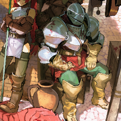
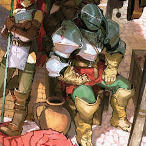
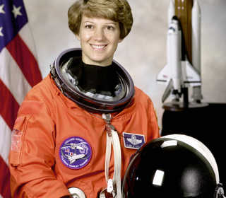

# FPGA JPEG Compression

A joint FPGA image-compression project implementing a complete RGB-to-JPEG encoder in SystemVerilog for the Digilent Nexys 4 DDR. Upload an image from a computer over USB-UART, encode it on the FPGA, and receive a ready-to-open JPEG file.

## Before and after

Both examples below use the project's encoder RTL. The left image is the RGB input; the right image is the decoded JPEG output.

| Input | FPGA JPEG output |
|:---:|:---:|
|  |  |
|  |  |

### Independent non-square photograph test

A NASA photograph of astronaut Eileen Collins was cropped from 512 x 512 to a non-square 512 x 448 source, then prepared as a **320 x 280** RGB frame. The complete RTL encoder produced a JPEG that decodes at **320 x 280** with all end-to-end and JPEG checks passing.

| Prepared 320 x 280 photograph | Decoded 320 x 280 JPEG |
|:---:|:---:|
|  |  |

The JPEG is **31,253 bytes** with **31.5 dB PSNR**. The [non-square source](examples/input/astronaut-source-512x448.png) and [original photograph](examples/input/astronaut-original-512x512.png) are included for reproduction. Photo: NASA, via scikit-image; public domain, with [source details](docs/image-sources.md). These results are from RTL simulation; hardware deployment is separately validated by the project team.

### Example results

| Example | Image size | Raw RGB | JPEG file | Raw-to-JPEG ratio | PSNR |
|---|---:|---:|---:|---:|---:|
| Color | 240 x 240 | 172,800 bytes | 24,448 bytes | 7.07:1 | 26.90 dB |
| Grayscale | 240 x 240 | 172,800 bytes | 19,716 bytes | 8.76:1 | 31.48 dB |

Results were checked in end-to-end RTL simulation. PSNR compares the decoded JPEG with the exact input RGB pixels. Compression ratios compare uncompressed 24-bit RGB bytes with the complete JPEG file, including headers. The color result also matches the project's bundled output byte for byte. See [validation](docs/validation.md) for the procedure.

## Highlights

- Baseline sequential JPEG with YCbCr 4:4:4 color encoding.
- RGB-to-YCbCr conversion, 8 x 8 block processing, 2-D DCT and quantization.
- Zigzag ordering, DC/AC symbol generation and Huffman coding.
- Bit packing, byte stuffing, JFIF headers and end-of-image generation on the FPGA.
- UART image upload and complete JPEG download through one Python command.
- Successful deployment on the Nexys 4 DDR FPGA, validated by the project team.
- Source images of different sizes accepted through the Python uploader.
- A 50 MHz encoder clock derived from the board's 100 MHz oscillator.
- LED status indicators and built-in serial self-test modes.

## Architecture

```text
Computer image -> UART RX -> RGB to YCbCr -> 8 x 8 buffering
                                                |
                                                v
                quantization <- 2-D DCT <- level shift
                     |
                     v
       zigzag -> DC/AC symbols -> Huffman -> bit packing
                                                |
                                                v
Computer JPEG <- UART TX <- output buffer <- JFIF wrapper
```

The project team successfully deployed and tested the encoder on the Nexys 4 DDR FPGA, including source images of different sizes. The Python uploader prepares each source image for the configured FPGA frame size, so images can be changed over UART while using the same bitstream.

The supplied board design defaults to 240 x 240 RGB frames with fixed quantization and Huffman tables. The encoder RTL is parameterized for other positive frame dimensions that are multiples of 8. For a different encoded frame size, set `IMG_W` and `IMG_H` in the FPGA build and use matching `--width` and `--height` options in the uploader. The UART header is checked against those compiled dimensions.

## Project structure

```text
.
├── README.md
├── rtl/                 # Encoder, buffering, JFIF and UART modules
├── constraints/         # Nexys 4 DDR clock and pin constraints
├── sim/                 # SystemVerilog testbenches
├── scripts/             # Portable Vivado creation and build scripts
├── host/                # Python upload and image verification utilities
├── bitstream/           # Supplied ready-to-program board bitstream
├── examples/
│   ├── input/           # Original demo images
│   └── output/          # Matching encoded JPEG files
└── docs/
    ├── images/          # Side-by-side comparison graphic
    ├── validation.md    # Verification procedure and evidence
    └── example-results.json
```

## Quick start

### 1. Prepare the computer

From the repository root, use a Nexys 4 DDR connected through its PROG/UART USB port with a data-capable cable. Install Vivado with Artix-7 device support and cable drivers for board programming. Install Python 3.9 or newer and the host dependencies. A virtual environment is recommended:

```bash
python3 -m venv .venv
source .venv/bin/activate
```

On Windows, activate the environment with `.venv\Scripts\activate` and use `python` where the commands below show `python3`.

```bash
python3 -m pip install -r host/requirements.txt
```

### 2. Program the board

Open Vivado Hardware Manager, connect to the board, and program:

```text
bitstream/jpeg_board_top.bit
```

The target FPGA is `xc7a100tcsg324-1`. To create a project and rebuild from source, see [Build from source](#build-from-source).

### 3. Upload and encode

Set switches SW0 and SW1 to OFF for normal image mode. Press and release CPU RESET before each image, then run:

```bash
python3 host/send_image.py examples/input/color.png \
  --port /dev/ttyUSB1 --baud 921600 --out encoded.jpg
```

Close any other program using the board's serial port. Choose the serial port assigned to your board. For example, Windows uses a port such as `COM5`. The script reports the sent byte count, receives the complete JPEG, saves it and checks that it decodes.

### Board indicators

| LED | Meaning |
|---|---|
| LED0 | Receiving the input image |
| LED1 | Encoding |
| LED2 | Sending the JPEG |
| LED3 | Transfer complete |
| LED15 | Header or buffering error indicator |

### UART interface

- 921600 baud, 8 data bits, no parity, 1 stop bit.
- FPGA receive: C4. FPGA transmit: D4.
- Host to board: `IMG`, 16-bit big-endian width, 16-bit big-endian height, then raster-order RGB bytes.
- Board to host: 32-bit big-endian JPEG byte count, then the complete JPEG file.
- At the 50 MHz core clock, `CLKS_PER_BIT = 54` is used by the supplied board RTL.

## Build from source

Run from the repository root with Vivado available on your command path:

```bash
vivado -mode batch -source scripts/create_project.tcl
vivado -mode batch -source scripts/build_bitstream.tcl
```

To build a 320 x 280 board design instead, pass the dimensions while creating the project:

```bash
vivado -mode batch -source scripts/create_project.tcl -tclargs 320 280
vivado -mode batch -source scripts/build_bitstream.tcl
```

Program the newly built `build/jpeg_fpga/jpeg_fpga.runs/impl_1/jpeg_board_top.bit`, then upload using matching options:

```bash
python3 host/send_image.py examples/input/astronaut-source-512x448.png \
  --width 320 --height 280 --port /dev/ttyUSB1 --out encoded.jpg
```

The scripts create `build/jpeg_fpga/`, select `jpeg_board_top`, load the Nexys constraints and build the bitstream. The supplied archive was created with Vivado 2026.1; the portable scripts target the same Artix-7 part.

## Simulation and image checks

The end-to-end custom-image testbench is `sim/tb_jpeg_jfif_top_240x240_custom.sv`, with top module `tb_jpeg_jfif_top`. It feeds the complete encoder and writes `fpga.jpg`, `scan.bin` and `input.ppm`.

Install Icarus Verilog (`iverilog` and `vvp`) and run from the repository root:

```bash
python3 scripts/run_sim.py examples/input/color.png --output-dir build/sim-color
python3 scripts/run_sim.py examples/input/astronaut-source-512x448.png \
  --width 320 --height 280 --output-dir build/sim-arbitrary
```

The helper prepares the image, compiles and runs the full testbench, then checks JPEG structure, dimensions and PSNR. Each selected output directory contains `fpga.jpg`, `input.ppm` and `simulation.log`.

For manual Vivado simulation, generate `image.hex` using `host/img2hex.py`, place it in the simulator working directory, set matching `W`/`H` testbench parameters, and run until completion. The simulation helper documents its Icarus compatibility handling separately from the unchanged source RTL.

See [validation](docs/validation.md) for the checked simulation workflow and source-integrity details.

## Main modules

| Module | Role |
|---|---|
| `jpeg_board_top` | Clocking, UART upload/download, reset and LEDs |
| `jpeg_encoder_jfif_top` | Complete JPEG stream and JFIF wrapping |
| `jpeg_encoder_top` | RGB front end and entropy coding integration |
| `dct_1d`, `dct_2d_top` | Transform stages |
| `quantizer` | Quantization with luminance/chrominance tables |
| `zigzag_reorder`, `rle_encode` | Coefficient ordering and symbol generation |
| `huffman_encode`, `huffman_tables` | Entropy coding |
| `bit_packer` | Bit packing and byte stuffing |

## Design references

The implementation follows the baseline JPEG processing stages: color conversion, block DCT, quantization, coefficient ordering and entropy coding. Standard-style quantization and Huffman tables are included directly in the RTL. The board interface uses the Nexys 4 DDR USB-UART connection and board-specific constraints.
